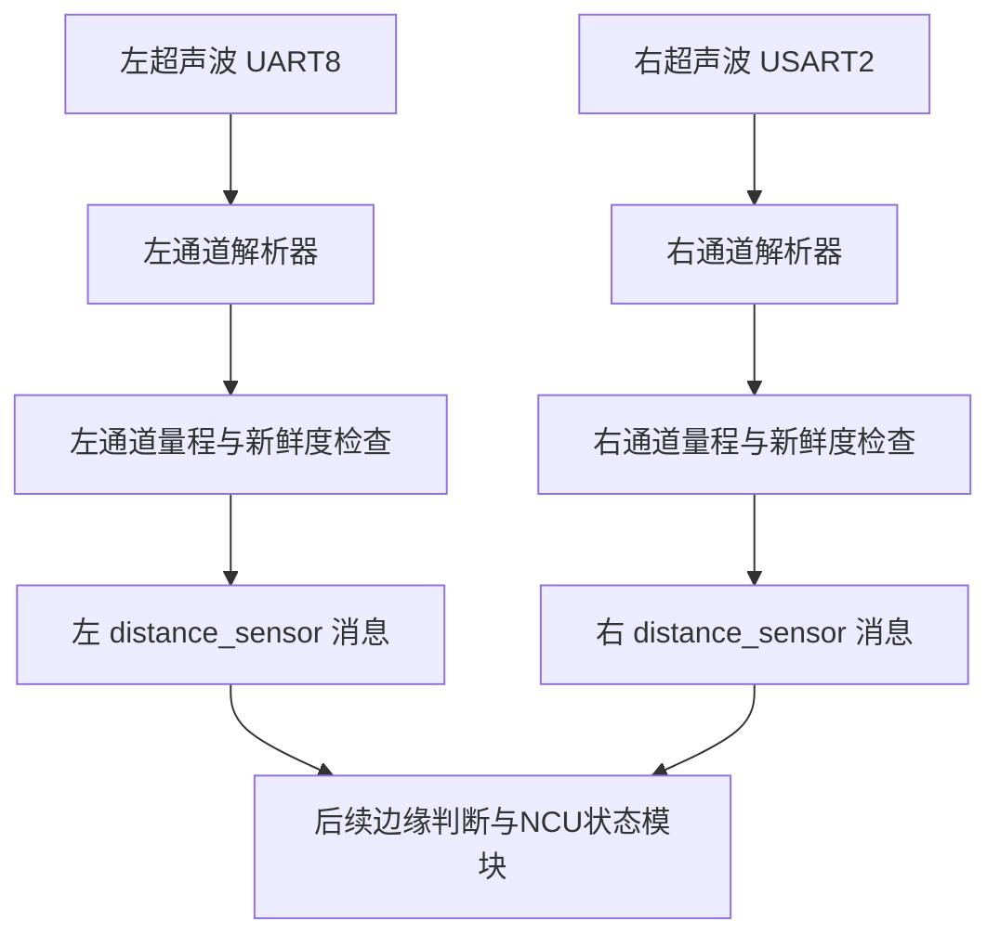

# 两路DYP-A02超声波功能实现过程说明

日期：2026-10-31。

对应任务：VGSolar光伏机器人APM→PX4迁移，输入外设阶段的第一步。

对应实现分支：`feat/vgsolar-px4-migration`。

对应功能提交：`f3a17158f366affc5bf0d85cc55b794e775f3dbd`；基础提交：`1501409c6c4a8c06c4b848e2d5c62f71bdf90d42`。

当前结果：两路采集驱动已实现，协议与数据有效性测试通过，VGSolar板型编译及固件打包检查通过。真实传感器的读数、接线、左右对应、精度和断流恢复尚待实板验证。本说明按已有提交回读整理，未为编写说明修改驱动或重新生成固件。

## 1. 这一步要完成什么

让PX4能够分别读取左外侧和右外侧超声波，将串口字节变成以米为单位的距离，并明确告诉后续模块：读数是否仍然有效。

本步包含串口配置、分包处理、帧校验、距离换算、量程检查、超时失效、标准消息发布和启停命令。边缘判断、急停锁存与电机停车需要在后续步骤接入。

用户已决定暂缓校准与磁航向问题，本步没有修改IMU/罗盘驱动、板旋转、校准参数或MBE配置，也没有启用执行器输出。

## 2. 第一步：从原APM工程提取接口和协议

参考仓库为WSL Ubuntu-22.04中的`/home/yuyuyyu/rover`，提交`5505db87886beb85383020d9d1376982babc988c`。

| 参考文件 | 提取的内容 |
|---|---|
| `libraries/AP_RangeFinder/AP_RangeFinder_DYP_A02.cpp` | 帧头、长度、校验方式、距离字节顺序及毫米转米规则 |
| `libraries/AP_RangeFinder/AP_RangeFinder_DYP_A02.h` | 自动输出串口模式、9600波特、8N1，以及原工程量程边界 |
| `libraries/AP_HAL_ChibiOS/hwdef/VGSolar/hwdef.dat` | 左右超声波所用硬件串口 |
| `libraries/AP_HAL_ChibiOS/hwdef/VGSolar/defaults.parm` | 左右实例的方向标签7、1及3～450cm量程 |

接着与当前PX4的`hardware-map.json`、NuttX串口配置核对，确定：

| 角色 | 硬件串口 | PX4设备文件 | MCU接收引脚 | 沿用的方向标签 |
|---|---|---|---|---|
| 左外侧 | UART8 | `/dev/ttyS7` | PE0 | 7 |
| 右外侧 | USART2 | `/dev/ttyS1` | PA3 | 1 |

这里的方向标签沿用APM项目配置，仍需核对实物安装；MCU引脚名也不能直接当成连接器针序。3～450cm是沿用的项目配置，尚未重新核实实际传感器型号的厂家规格。

## 3. 第二步：确定PX4中的程序结构

在PX4源码中新增`src/drivers/distance_sensor/dyp_a02/`目录，使用原工程相同的通信协议，通过PX4已有的驱动接口重新组织程序。

程序分成两层：

- `Protocol.hpp`处理字节解析和样本有效性，不依赖PX4硬件，便于在电脑上测试。
- `DypA02.cpp`处理真实串口、任务调度、左右通道管理、状态输出以及PX4消息发布。

`DypA02`使用`ModuleBase`提供`start/status/stop`命令，使用`ScheduledWorkItem`加入PX4工作队列。一个工作项管理左右两路，每路都有自己的串口句柄、解析器、距离样本、发布对象及错误计数。



## 4. 第三步：配置并读取串口

`open_channel()`先检查设备路径格式和串口编号，再以非阻塞方式打开串口。两路必须指定不同设备，任一路打开或配置失败时，启动返回失败并关闭已打开的句柄。

串口设置为9600波特、8个数据位、无奇偶校验、1个停止位；关闭流控、回显和字符转换，按二进制数据读取。启动时清空旧的接收缓存。

驱动请求每10ms运行一次，每次每路最多读取128字节。串口没有数据时直接返回，不停下来等待；某一路大量噪声也不会让单轮读取无限延长。10ms是软件请求的检查周期，不是传感器测距频率保证，实际调度还受系统负载影响。

传感器使用自动输出协议，驱动没有调用发送函数，也不发送触发测距指令。其他触发式或不同帧协议的型号不能直接视为兼容。

## 5. 第四步：把接收到的字节解析成距离

原协议每包4字节：

| 字节 | 含义 |
|---|---|
| 第0字节 | 固定帧头`0xFF` |
| 第1字节 | 距离高8位 |
| 第2字节 | 距离低8位 |
| 第3字节 | 前3字节累加和的低8位 |

换算方式：

```text
距离毫米 = 高字节 × 256 + 低字节
校验和 = (0xFF + 高字节 + 低字节) mod 256
距离米 = 距离毫米 × 0.001
```

例如收到`FF 00 96 95`：`0x0096=150`，所以距离为150mm，即0.15m；前三字节之和为`0x195`，低8位正好为`0x95`。

解析器逐字节处理数据，因此一个包分两次读到、多个包一次读到，都能正常处理。距离字节本身也可能等于`0xFF`，不能每遇到`0xFF`就直接重启解析。

校验失败时，计数加一，并在已收字节中保留可能成为下一帧起点的`0xFF`，继续寻找合法包。未收完的半包在后续字节到达时，如间隔超过50ms，就清空半包状态。该间隔根据驱动读取字节的时间判定，不是UART线上逐字节的硬件时间戳。

一次读取中出现多个完整帧时，解析器依次处理，最终发布这一批中最后一个完整帧对应的样本。坏校验帧不刷新样本时间。

## 6. 第五步：处理有效、越量程和过期状态

`Sample`保存最近一次校验正确帧的距离及接收时间。样本同时满足以下条件才可使用：

1. 已收到完整且校验正确的帧。
2. 距离在30～4500mm范围内。
3. 距离该帧接收时间不足500ms。

| 情况 | 程序行为 |
|---|---|
| 启动后没有数据 | 发布无效状态 |
| 收到量程内完整帧 | 更新距离并发布有效状态 |
| 收到量程外完整帧 | 最后样本变为无效，不继续保留旧有效距离 |
| 收到坏校验帧 | 不接受该帧；之前样本仍按自己的接收时间计算是否过期 |
| 没有校验正确帧达到500ms | 下次运行检查时撤销样本有效性 |
| 恢复收到正常帧 | 自动恢复有效发布 |
| 执行stop | 发布禁用、无效状态，再清理资源 |

发布无效数据时采用`current_distance=0`、`signal_quality=0`。0低于配置量程，是失效占位，后续模块必须结合有效性和量程判断，不能将其理解成“距离很近，因此安全”。采用有限距离值，也避免当前MAVLink距离消息把NaN直接转换为无符号整数。

有效数据的`signal_quality=-1`表示传感器没有提供质量百分比，不代表测量质量差。失效状态等待期间约每100ms重发一次；500ms新鲜度阈值及这些周期均为本步软件设计值，尚未通过实板时序采样确认，也不是整车停车时间承诺。

## 7. 第六步：发布PX4标准消息并加入板型

驱动使用`PX4Rangefinder`，左右各发布一个`distance_sensor`实例。消息包含距离、设备ID、传感器类型、方向标签、量程、模式和质量标志。

每路设备ID由串口总线号和本地设备类型编号组成，因此左右设备ID不同。当前新增类型值为`0xED`，只保证本源码树中未重复，不代表上游已分配该编号。实例序号由运行时分配，后续识别左右应核对设备ID和方向标签。

接入板型时，修改了三个位置：

1. 在`default.px4board`中选择`CONFIG_DRIVERS_DISTANCE_SENSOR_DYP_A02=y`，使驱动进入固件。
2. 新增参数`VGS_RNG_EN`，默认0，用来控制本板开机自动启动两路超声波。
3. 在`rc.board_sensors`加入启动条件，参数等于1时执行左右固定串口的启动命令。

参数默认0，便于先手动测试接线和读数；确认后再启用开机启动。原有USART3控制台、IMU和罗盘启动配置保持原状。

## 8. 第七步：测试与构建

先对实际使用的`Parser`和`Sample`代码进行电脑端测试，再编译真实VGSolar固件。

| 测试内容 | 验证目的 | 结果 |
|---|---|---|
| 固定黄金帧`FF 07 A1 A7` | 应得到1953mm | 通过 |
| 分包、连续包 | 接收边界变化不影响解包 | 通过 |
| 错校验与重叠帧头 | 坏包被拒绝，随后可恢复同步 | 通过 |
| 半包超时 | 陈旧半包不能无限保留 | 通过 |
| 全部65536种16位负载 | 包括数据字节为`0xFF`的情况 | 通过 |
| 双通道隔离 | 左路半包不影响右路解析 | 通过 |
| 30/4500mm及相邻越界值 | 边界与有效性判断正确 | 通过 |
| 500ms边界、失效与恢复 | 陈旧值被撤销，正常数据恢复 | 通过 |
| AddressSanitizer、UndefinedBehaviorSanitizer | 检查上述主机测试执行路径的内存和未定义行为问题 | 通过 |
| `vg_vgsolar_default`交叉编译 | 驱动能与实际板型、PX4接口链接 | 通过 |
| 固件包与BIN比较、HEX反向检查 | 确认打包内容和应用起始地址一致 | 通过 |
| 固件符号检查 | 新驱动进入镜像，PWM/DShot/PX4IO硬件驱动仍未加入 | 通过 |

构建过程中根据编译反馈调整了PX4参数定义文件的处理方式，并将命令行解析的局部变量改成避免与系统宏重名的名称；最终版本已编译通过。主机测试没有模拟真实声学测量或硬件UART，不能据此认定接线、精度或实物断线行为已验证。

最终固件应用大小为1,185,548字节，占配置的1792KiB应用区约64.61%。仅应用HEX从`0x08020000`开始，不包含Bootloader。

## 9. 新增和修改了哪些文件

以下路径均相对于WSL XTDrone2-24.04中的`/home/yu/PX4-Autopilot`：

| 文件 | 作用 |
|---|---|
| `src/drivers/distance_sensor/dyp_a02/DypA02.cpp` | 串口、左右通道、运行调度、启停、状态输出和消息发布 |
| `src/drivers/distance_sensor/dyp_a02/Protocol.hpp` | 帧解析、量程与新鲜度检查 |
| `src/drivers/distance_sensor/dyp_a02/parameters.c` | 定义开机使能参数 |
| `src/drivers/distance_sensor/dyp_a02/Kconfig` | 注册可选驱动配置 |
| `src/drivers/distance_sensor/dyp_a02/CMakeLists.txt` | 注册驱动构建及依赖 |
| `src/drivers/distance_sensor/dyp_a02/test/protocol_test.cpp` | 协议和样本状态测试 |
| `src/drivers/drv_sensor.h` | 新增本地设备类型编号 |
| `boards/vg/vgsolar/default.px4board` | 在本板固件中编入驱动 |
| `boards/vg/vgsolar/init/rc.board_sensors` | 按开关参数启动两路采集 |
| `docs/vgsolar/README.md` | 记录迁移顺序和当前状态 |
| `docs/vgsolar/STEP01_DYP_A02.md` | 构建方法、实板步骤和验收边界 |

## 10. 如何使用和验收

先导出当前参数，按已有方式更新本步仅应用固件，保留Bootloader，保持动力断开。手动启动：

```sh
dyp_a02 start -l /dev/ttyS7 -r /dev/ttyS1
dyp_a02 status
listener distance_sensor -i 0 -n 5
listener distance_sensor -i 1 -n 5
```

先确认哪一路消息对应左侧、哪一路对应右侧，再分别用10、15、20、50cm的已知距离检查读数。随后对一侧停止数据流，观察其有效性是否撤销、另一侧是否继续更新；恢复数据流后检查自动恢复。测试时确认logger确实在写完整SD文件，保留本轮ULog及参数。

默认日志中距离话题约1Hz，适合检查读数和持续失效，精确测量500ms失效时序还需要更细的采样或专门测试。当前未取得本步实板数据，尚不能填写“实板验收通过”。

停止采集：

```sh
dyp_a02 stop
```

两路台架验证通过后，选择启用开机启动：

```sh
param set VGS_RNG_EN 1
param save
reboot
```

要关闭开机启动，将该参数设置为0、保存并重启；当前运行中的采集可用stop停止。需要回退时使用保留的B3应用和对应参数备份，不能只假定回退程序就恢复了所有参数状态。

## 11. 完成情况与下一步

本步建立了从“左右超声波串口字节”到“PX4可读取且能识别失效的距离消息”的数据路径。软件测试和固件构建完成，实板验收待完成。

当前驱动将150mm与160mm都作为量程内有效距离。后续边缘检测模块再依据项目规则判断“任一路无效或距离大于150mm”，加入消抖、停止请求、锁存及输出联锁，并分别测试。距离采集成功本身不代表机器人已具备防跌落或自动停车能力。

按当前迁移安排，先完成这两路输入的实板确认，再推进负压ADC、红外输入；整个过程中继续保留磁航向待验收项。
