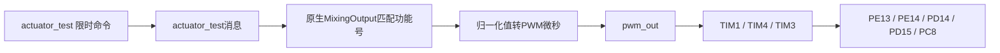

# 第02步：五路PWM配置、实现过程和实板测试

日期：2026-10-31。用户要求先配置PWM测试，超声波实板验收保留待完成，校准及磁航向继续暂缓。开发分支：`feat/vgsolar-px4-migration`；本步基础提交：`16a65e742e97901f1e6e495520b2e1ad3825423b`。

## 1. 本步目标和当前状态

启用本板五路硬件PWM，使用户能够在电机、电调、滚刷及升降机构动力断开的电子台架上，用示波器或逻辑分析仪验证通道、周期和脉宽。本步复用PX4原生`pwm_out`和`actuator_test`；当前没有建立车辆运动控制、边缘停机、NCU控制或急停联锁验收。

软件配置和脚本检查、板型编译可在主机完成；五路物理波形、启动瞬间行为、停止后电平、重启行为仍待实测。不要连接机构负载来代替第一轮波形检查。PWM信号不是负载供电，USB也不能据此被视为给舵机或电机供电。

## 2. 先核对资源，确定五路映射

依据APM VGSolar `hwdef.dat`、IO资源文档以及当前PX4 `hardware-map.json`和`timer_config.cpp`交叉核对：

| 本次PX4通道 | MCU引脚 | 硬件定时器 | 参数中的定时器组 | 原AP输出编号/预留用途 | 台架测试功能号 |
|---|---|---|---|---|---|
| 1 | PE13 | TIM1 CH3 | PWM_MAIN_TIM0 | PWM3 / 左履带 | 301 |
| 2 | PE14 | TIM1 CH4 | PWM_MAIN_TIM0 | PWM4 / 右履带 | 302 |
| 3 | PD14 | TIM4 CH3 | PWM_MAIN_TIM1 | PWM5 / 升降 | 303 |
| 4 | PD15 | TIM4 CH4 | PWM_MAIN_TIM1 | PWM6 / 后刷 | 304 |
| 5 | PC8 | TIM3 CH3 | PWM_MAIN_TIM2 | PWM9 / 前刷 | 305 |

本表的通道1～5是PX4资源数组顺序；原AP PWM1/2/7/8对应的PA8、PE11、PA0、PA1继续留给编码器，不参与本次输出。TIM8继续供HRT系统时基使用，PC8使用TIM3。MCU脚名不是连接器针序，探头接点须按实际PCB/IO图对应，不猜FPC针脚。

TIM1的通道1/2共用输出频率，TIM4的通道3/4共用频率，通道5单独一组。首次统一50Hz：周期应约20ms。未来若升降舵机和后刷要求不同频率，需要处理共享TIM4的兼容性，不能独立设置冲突频率。

## 3. 接入原生PWM和台架命令

在`boards/vg/vgsolar/default.px4board`启用：

```text
CONFIG_DRIVERS_PWM_OUT=y
CONFIG_SYSTEMCMDS_ACTUATOR_TEST=y
```

原生启动脚本`rcS`会尝试启动`pwm_out`，因此新增板级默认参数将五路`PWM_MAIN_FUNC1～5`设为0，即未分配功能；DIS与FAIL均设为0，目标为无有效高电平PWM脉冲。原生驱动会初始化定时器和引脚，默认禁用功能不等于始终保持五个引脚为GPIO输入；需实测启动波形。

三组TIM参数的板级默认值为50；MIN/MAX/CENT为1000/2000/1500微秒；REV为0。它们是台架量测标尺，不是本机电调的中位、停止、反向或运动标定。参数描述文件中的原生默认值可能仍显示400Hz、DIS=1000，板级启动脚本通过set-default设置本板默认值；实际生效值必须从实板读回。

`set-default`不会覆盖此前已保存参数，升级前导出完整参数，升级后先检查PWM_MAIN参数。校准、板旋转、IMU/罗盘代码和超声波驱动保持原状。本次仅启用PWM，没有启用DShot或PX4IO。

## 4. 手动准备脚本和清理脚本

两个脚本随固件放入`/etc/extras/`，不在启动流程中自动调用：

- `vgsolar_pwm_setup.nsh`：先停止PWM，再清空旧功能，设置三组50Hz、零DIS/FAIL和测试范围，将五路分别映射到301～305，最后启动PWM。
- `vgsolar_pwm_off.nsh`：先停止PWM，再把五路FUNC/DIS/FAIL清零并保存；不重新启动驱动。

若正在运行的PWM停止失败，脚本返回失败并中止后续操作。准备脚本不解锁、不发送测试脉冲；实际测试要另行调用限时命令。脚本中的设置可能被PX4自动保存，不能假定重启会清空测试映射，测试结束须运行清理脚本。

301～305为原生`Peripheral_via_Actuator_Set`通用外设功能。采用它们可直接使用[-1,+1]归一化测试值，不叠加电机推力曲线或舵机trim。本阶段它们仅作波形测试映射，尚未分配最终机器人控制功能。不要让外部程序同时向这些通用外设发送控制命令。

## 5. 实际输出路径



本次参数下，未反相且没有其他控制源干预时，原生线性换算为：

```text
value = -1  → 1000 us
value =  0  → 1500 us
value = +1  → 2000 us
```

原生`actuator_test`在未解锁且未触发kill的条件下覆盖输出；lockdown/kill仍可能使输出回DIS值。无需为测试强制解锁、关闭安全检查或修改航向参数。每条命令显式使用`-t 3`，3秒到期后撤销测试覆盖；它依赖驱动任务正常运行，不等于硬件急停或进程卡死时的停止保证。

## 6. 第一轮实板测试：先看状态，再测第1路

前置条件：板子固定，电机/电调/机构动力与执行端连接断开，只接板子和量测设备；示波器/逻辑分析仪参考地与板地连接，探头电压范围按板上实际信号电平设置。沿用已有“仅应用”更新方法，保留Bootloader，不全片擦除。记录升级前参数及回退固件。

更新后先执行：

```sh
ver all
param show PWM_MAIN*
pwm_out status
```

初始目标为五路FUNC=0、DIS=0、FAIL=0，TIM0/1/2=50。确认动力断开后执行：

```sh
sh /etc/extras/vgsolar_pwm_setup.nsh
pwm_out status
param show PWM_MAIN*
```

应看到五路FUNC分别301～305、DIS/FAIL为0、范围1000～2000、REV=0，三组频率50Hz。`pwm_out status`中的通道编号从0计数，其0～4对应表格的1～5。准备结束但尚未发测试命令时，检查是否无有效PWM脉冲，若已有脉冲先停止并保留状态，不直接接负载。

探头接PE13对应的实际输出测试点，第1路先测1500微秒：

```sh
actuator_test set -f 301 -v 0 -t 3
```

预期：仅第1路出现约50Hz、1500us高电平宽度，约3秒后恢复无有效PWM脉冲。其他四路同时监测，不应出现同样测试输出。命令返回成功和`actuator_outputs`数值都不能替代物理波形证据。

确认后，分开执行以下两条，等待每次测试结束：

```sh
actuator_test set -f 301 -v -1 -t 3
actuator_test set -f 301 -v 1 -t 3
```

分别预期1000us和2000us。当前1000～2000us仅用于测量，不可据此让履带或刷子实际运动。若没有波形，回传ver、PWM参数、pwm_out status和测试命令输出，先查通道、状态与接点，不强制解锁。

## 7. 第1路确认后，逐路检查其余通道

依次在对应引脚测量，每条运行3秒并等待结束：

```sh
actuator_test set -f 302 -v 0 -t 3
actuator_test set -f 303 -v 0 -t 3
actuator_test set -f 304 -v 0 -t 3
actuator_test set -f 305 -v 0 -t 3
```

每路再分别测-1、+1，记录实际频率、高电平宽度、输出电平、非目标通道状态和超时后的停止波形。保留截图、接点说明和本轮ULog。若要验证上电/复位无异常脉冲，需用仪器触发捕捉，单看启动后的静态波形不足以证明没有启动毛刺。

## 8. 收尾

```sh
sh /etc/extras/vgsolar_pwm_off.nsh
param show PWM_MAIN_FUNC*
pwm_out status
```

目标：五路功能恢复0，PWM驱动停止，物理波形消失；脚本保存禁用状态。若脚本报错或波形持续，先切断板子供电并保留信息。这个清理动作恢复台架禁用基线，不恢复所有测试前的自定义参数；原完整状态依靠升级前参数备份。

## 9. 软件验证与当前缺口

`Tools/vgsolar/check_pwm_bench.py`检查五路资源顺序、编码器引脚排除、HRT保留、默认禁用参数，并以模拟命令执行实际准备/清理脚本，验证停止先于参数修改、清理不重启、停止失败即中止。它不接触硬件，也不模拟STM32电气波形。

板型构建验证原生PWM和actuator_test进入固件，DShot/PX4IO保持缺席，测试脚本确实进入ROMFS；仅应用HEX需与BIN反向比较，并核对应用起始地址0x08020000。具体构建commit和哈希见交付核对JSON。

当前待实板验证：五路输出对应关系、50Hz和1000/1500/2000us、非目标通道、超时停止、停止/重启/复位波形。没有实测前不标记T09通过，更不放行连接动力的T10；完整运动丢控、急停与边缘联锁仍须后续实施。

## 10. 文件与源码依据

本步板级修改：`default.px4board`、`init/rc.board_defaults`、`src/board_config.h`、`src/timer_config.cpp`、`src/init.c`；新增两份extras手动脚本、主机检查脚本和本说明，关键处有中文注释。

原生实现依据：`src/drivers/pwm_out/PWMOut.cpp/.hpp`、`module.yaml`；`src/systemcmds/actuator_test/actuator_test.cpp`；`src/lib/mixer_module/actuator_test.cpp`、`mixer_module.cpp`、`functions/FunctionActuatorSet.hpp`；`platforms/nuttx/src/px4/stm/stm32_common/io_pins/pwm_servo.c`；`ROMFS/CMakeLists.txt`的board extras打包规则及`rcS`的PWM启动流程。
