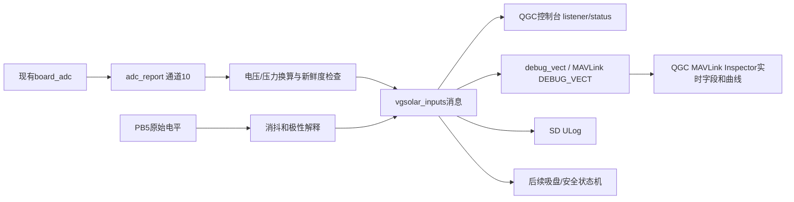

# 第03步：吸盘负压和红外输入实现过程说明

日期：2026-10-31。分支`feat/vgsolar-px4-migration`，基础提交`2d5943be16`。用户确认继续使用MCP-H10-P 3.3V负压传感器和原接线：压力PC0，红外PB5。用户反馈PWM应该均无明显问题，本步继续输入迁移；PWM完整量测和整车输出安全仍独立保留待验收。

## 1. 本步目标

建立压力/红外输入到PX4消息、控制台、QGC实时检查和SD日志的数据路径，作为后续吸附、升降和故障判断的输入。只读采集，不写泵、阀、舵机或履带，不根据压力值启动机构。IMU、罗盘、板旋转和原校准保持原状；不修改现有超声波及PWM逻辑。

## 2. 对照原APM提取接口与语义

参考APM提交`5505db87886beb85383020d9d1376982babc988c`：

- `AP_SuctionPressure.cpp/.h`：0.1V=0kPa、3.1V=−100kPa，5Hz低通，约100ms连续有效预热和250ms采样过期；不使用气压高度话题。
- `AP_SuctionCup.cpp`、`AP_SuctionCup_IR.cpp`：PB5/GPIO98，下拉输入，默认高电平=有铁片，低电平=无铁片，允许反相；默认30ms消抖。
- VGSolar硬件定义、IO文档及当前PX4板级配置：PC0为ADC1通道10，已在板载ADC扫描表内；PB5已作为下拉输入初始化。

原APM中“放下到位”还要求本次动作先见有铁片再见无铁片，不能仅看一个静态低电平。本步只迁移输入和极性解释，未迁移吸盘状态机，也没有提供“已安全放下”的结论。

## 3. 软件结构和新增文件

| 文件 | 用途 |
|---|---|
| `src/modules/vgsolar_inputs/InputProcessing.hpp` | 压力换算、滤波、有效性、时间检查和红外消抖的纯计算层，含中文注释 |
| `src/modules/vgsolar_inputs/VgsolarInputs.cpp` | PX4任务、参数、ADC订阅、GPIO读取、状态与消息发布 |
| `src/modules/vgsolar_inputs/parameters.c` | 开机开关及压力端点/滤波、红外极性/消抖参数 |
| `src/modules/vgsolar_inputs/test/processing_test.cpp` | 计算层主机测试 |
| `src/modules/vgsolar_inputs/Kconfig`、`CMakeLists.txt` | 将模块接入板型构建 |
| `msg/VgsolarInputs.msg`、`msg/CMakeLists.txt` | 注册专用`vgsolar_inputs`消息 |
| `boards/vg/vgsolar/src/board_config.h` | 为原有PC0通道与PB5定义清晰名称，复用原引脚配置 |
| `boards/vg/vgsolar/init/rc.board_sensors` | 按开关参数启动采集 |
| `src/modules/logger/logged_topics.cpp` | 默认日志配置中按20ms间隔可选订阅输入消息 |



## 4. 复用ADC采样，不重新配置ADC

`board_adc`仍是ADC的采样者，当前约100Hz发布`adc_report`。新模块每20ms运行一次，读取最新板内ADC消息，在`channel_id[]`中查找10，不能把数组第10个元素当成通道10。

电压计算：`raw_data × v_ref / resolution`，参考电压和分辨率均来自报告，避免写死12位/16位。负值、计数超界、分辨率为0或非法参考电压不能进入有效压力路径。模块不调用ADC初始化、不修改其他扫描通道，因此电池电压电流仍可订阅原有数据源。

## 5. 压力换算、滤波与有效性

默认换算为：

```text
压力kPa = 0 + (电压 − 0.1) × (−100 − 0) / (3.1 − 0.1)
0.1V → 0kPa
1.6V → −50kPa
3.1V → −100kPa
```

参数可配置对应两个电压/压力端点。错误配置明确报告无效，不静默回退；端点必须有限且不同，电压端点顺序正确、处于0.02～3.28V内，压力端点在−150～50kPa配置范围内。PX4参数元数据不接受kPa单位标签，本实现把kPa明确写入参数说明、控制台和消息字段，不错误标成Pa。

有效电压窗口沿用APM端点外0.1V容差，同时附加0.02～3.28V近轨保护；默认有效窗口约0.02～3.2V。此处与原APM允许0V的窗口有明确差异：0V直接无效，防止接近地电位被换算为可信压力。该规则仍不能可靠识别所有断线：原硬件R95未安装，悬空也可能落在有效窗口。

连续新采样有效100ms后才报告健康；单次坏值立即撤销有效压力。达到250ms没有新ADC采样，压力状态变为过期。重复时间戳不能累计健康时间；未来或已经陈旧的时间戳也不能变成新有效数据。无效后恢复需重新预热，滤波重新起算，避免沿用旧压力。

滤波默认5Hz，采用一阶低通，按实际相邻采样时间计算系数；0Hz参数表示旁路。`pressure_raw_kpa`保留有效样本的瞬时换算值，`pressure_kpa`仅健康时提供滤波值，未健康/过期时为NaN。`pressure_voltage_v`是最近电压诊断值，可能陈旧，不能单独视为当前有效。

本步不实现−70kPa持续300ms、建压10秒等吸附流程判据，留待状态机迁移。

## 6. 红外输入处理

每20ms读取PB5，保留原始电平；候选电平稳定达到30ms后才更新消抖结果。受20ms检查周期影响，实际接受延迟还要加调度和采样量化，不能保证恰好30ms。

`VGS_IR_INV=0`时，高表示有铁片；设置1时反相。`ir_sample_valid`只表示采样/消抖状态已经有效，不证明传感器接线完整，也不证明舵机处于某个机械位置。输入恒低与断线下拉都可能得到同样电平，后续动作必须验证“先有铁片、再无铁片”的变化和超时。

## 7. 参数和诊断

| 参数 | 默认值 | 含义 |
|---|---:|---|
| VGS_IN_EN | 0 | 是否在开机时启动本模块，默认先手动测试 |
| VGS_P_VMIN / VGS_P_VMAX | 0.1 / 3.1 | 两个电压端点，V |
| VGS_P_PMIN / VGS_P_PMAX | 0 / −100 | 对应压力端点，kPa |
| VGS_P_FILT | 5 | 压力低通截止频率，Hz；0旁路 |
| VGS_IR_INV | 0 | 红外极性是否反相 |
| VGS_IR_DEB | 30 | 红外消抖时间，ms |

压力状态：0等待ADC；1预热；2健康；3电压无效；4过期；5配置错误；6ADC来源或通道缺失；7ADC数值错误；8模块停止。

修改本模块参数时按需重新初始化对应处理状态；其他模块参数变化不会反复重置压力预热。停止模块时主动发布enabled=false及无效压力/红外状态；后续消费者仍须检查消息timestamp，防止模块意外停止后使用最后一条消息。

模块每20ms同步发布`debug_vect`，名称为`VGS_PRESS`：`x`为最近一次PC0 ADC电压(V；ADC不更新时可能是旧值)，`y`为健康时的滤波压力(kPa)，`z`为压力有效标志(1有效/0无效)。无效时压力值为NaN，停止模块时发送无效标记。使用PX4现有MAVLink `DEBUG_VECT`流，不修改MAVLink协议定义；当前USB/QGC配置已将该流设为50Hz，消息只在输入模块发布时出现。该调试向量不纳入后续控制，控制消费者仍应订阅`vgsolar_inputs`并检查状态和时间戳。

QGC实时查看：进入“Analyze Tools → MAVLink 检测(MAVLink Inspector)”，展开本机车辆的`DEBUG_VECT`，找到`name=VGS_PRESS`；查看/勾选`x`、`y`、`z`字段即可观察实时值及曲线。`DEBUG_VECT`是开发调试遥测，不是Fly View的标准气压仪表；若Inspector未显示，先核对USB MAVLink链路和`vgsolar_inputs`是否运行，再检查飞控端`mavlink status`中的USB实例及流配置。QGC Inspector可显示并绘制收到的MAVLink消息字段。

## 8. 测试与验证边界

主机测试使用实际计算代码，覆盖ADC不同分辨率、坏计数/元数据，压力端点/中点、100ms预热、重复/陈旧/未来时间戳、250ms超时、近轨/非法电压、错误参数、滤波/旁路、无效恢复，以及红外30ms边界、毛刺、反相、采样过期与重新初始化。测试带AddressSanitizer和UndefinedBehaviorSanitizer。

在PX4仓库根目录复算：

```sh
g++ -std=c++14 -Wall -Wextra -Werror -fsanitize=address,undefined -g src/modules/vgsolar_inputs/test/processing_test.cpp -o /tmp/vgsolar_inputs_test
/tmp/vgsolar_inputs_test
source /home/yu/.venvs/px4-117/bin/activate
make -j4 vg_vgsolar_default
```

板型交叉编译检查本模块、专用消息、日志接入和DEBUG_VECT发布；软件通过不能替代传感器电压/压力表比对或机械位置测试。固件commit、哈希和实际构建记录随交付保存。

## 9. 第一轮实板操作

先结束之前持续PWM测试，动力和机构仍断开：

```sh
sh /etc/extras/vgsolar_pwm_off.nsh
```

保存当前完整参数和PWM版本回退镜像，沿用仅应用更新方式，保留Bootloader。新固件不会主动覆盖已保存PWM参数，不能依靠刷入来停止持续上锁输出。

更新后先执行：

```sh
ver all
param show VGS_*
board_adc status
vgsolar_inputs start
vgsolar_inputs status
listener vgsolar_inputs -n 3
```

第一轮只回传原接口静置读数，不开泵、不动升降。核对PC0电压与万用表、当前压力状态和红外原始电平。近大气压时，在传感器供电正确且校准吻合的条件下应接近0.1V/0kPa。软件healthy只能表示当前电压和数据时间符合规则，不能证明传感器已连接或已经吸附。

确认静态采样后，再用手动遮挡/释放红外，检查原始电平及消抖变化。不要直接将5V信号接入未核实的MCU输入。后续使用受控电压源/压力表做0.1/1.6/3.1V及实际压力多点比对，输入上限按板上3.3V ADC约束，接线及仪表先核实。

使用受控电压源模拟传感器时，先断开传感器信号输出，电压源地与飞控地共地，确认输出不超过3.3V，再接PC0；不要让传感器输出与外部电源直接并联。保持输入模块运行，在QGC Inspector中观察`DEBUG_VECT/VGS_PRESS`：x约为输入电压，y约为按标定换算并低通后的压力，z应为1。稳定输入0.1/1.6/3.1V时，y分别应接近0/−50/−100kPa；考虑ADC量化、参考电压误差与滤波，先以万用表在PC0对板地测得的实际电压作为换算核对依据。断开信号源或输入越界后，z应转为0；无效压力不应继续作为有效曲线值使用。

确认logger确实写SD完整文件后保留ULog。只读断流测试需要专门控制ADC数据源，不能通过停止board_adc来做常规测试，因为它也给电池模块供数；250ms过期先由主机测试覆盖，实板故障测试另行设计。

临时停止：`vgsolar_inputs stop`。实板确认后，如需开机运行，设置`VGS_IN_EN=1`、保存并重启；设置0并重启关闭自动启动。标定参数属于压力传感器，不改变IMU/罗盘校准。

## 10. 当前阶段结论

本步交付只读输入软件、QGC实时调试遥测和可复测固件；QGC地面端实收仍待用户现场确认，压力/电压精度和红外极性也仍待实测。用户已确认型号和原接线，这不能替代硬件验收。压力、红外通过后，再接边缘检测与最小安全层，随后考虑机构单步控制；继续保留磁航向待验收项。
